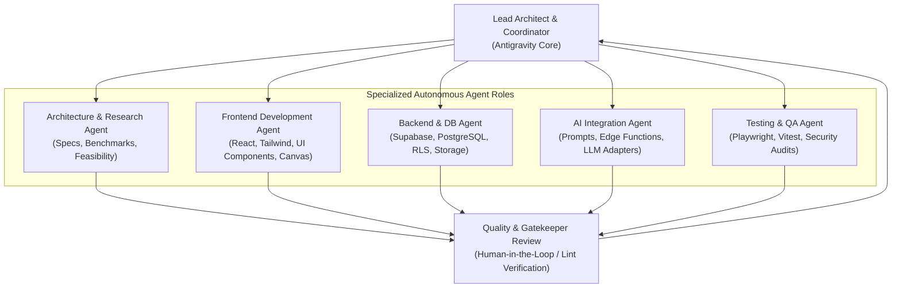
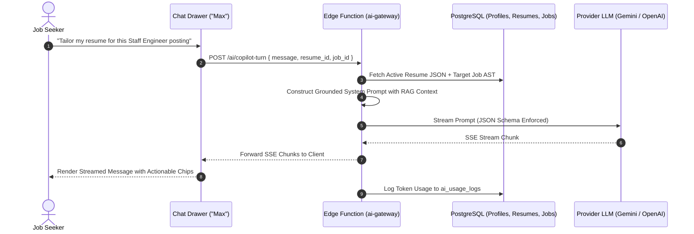

# AI Agent Architecture & Multi-Agent Orchestration — ResuMax AI

**Status:** Phase 0 Approved Architecture  
**Platform Integration:** Google Antigravity + REA (Reverse Engineer Anything) Engine  
**Orchestration Paradigm:** Specialized Role-Based Multi-Agent Hierarchy with Human-in-the-Loop Review

---

## 1. Development-Time Multi-Agent Orchestration

To build and maintain ResuMax AI with enterprise reliability, Antigravity coordinates specialized agents operating with clear separation of duties:

### Agent Roles & Work Breakdown:
1. **Lead Architect & Coordinator (Antigravity):**
   * Maintains single source of truth (`docs/`).
   * Manages task queues and validates milestones.
   * Prevents unapproved structural drifts.
2. **Architecture & Research Agent:**
   * Benchmark competitor platforms, evaluate schema migrations, and maintain PRD documents.
3. **Frontend Engineering Agent:**
   * Implements React 18/19 components, Tailwind design tokens, Zustand stores, and `@react-pdf/renderer` layouts.
4. **Backend & Security Agent:**
   * Designs PostgreSQL tables, writes RLS policies, configures Supabase Storage, and audits SQL indices.
5. **AI Integration Agent:**
   * Crafts Zod-validated prompt schemas, implements Edge Functions, and manages provider-agnostic fallbacks.
6. **Testing & QA Agent:**
   * Writes unit tests (Vitest), end-to-end user journeys (Playwright), and performs automated security scans.

### Gatekeeper Rules:
* **No Unilateral Merges:** Autonomous agents may work in isolated branches or staged files; changes require verification against linting, type-checking (`tsc`), and test suites before merging into main.
* **Preservation of Untouched Assets:** Absolute ban on modifying legacy projects (`ResumeForge AI`).

---

## 2. REA Integration Strategy & Workflows

### 2.1 Role of REA in ResuMax AI
The REA (Reverse Engineer Anything) MCP server (v6.7.0, skill v42) provides specialized tooling in Antigravity.

* **Standard Code Development Boundary:** Ordinary React/TypeScript code generation, repository browsing, and refactoring use standard Antigravity file and shell tools (`read_file`, `write_file`, `edit_file`, `run_command`).
* **REA Tooling Deployment Scenarios:**
  1. **Document & Binary Layout Analysis:** Using REA artifact and pcap inspection tools if analyzing low-level document streams or proprietary export formats.
  2. **Browser & Scenario Captures:** Utilizing REA's browser inspection capabilities (`observe_web_execution`, `capture_browser_scenario`, `compare_web_captures`) for automated visual regression testing and ATS render auditing.
  3. **Runtime Semantics Verification:** Verifying bundled JavaScript outputs against source maps using `trace_javascript_semantics` and `compare_source_to_bundle`.

---

## 3. Application-Level AI Copilot ("Max" Architecture)

In addition to developer-time agents, ResuMax AI features an in-app career copilot named **"Max"** (inspired by ResuMax's "Atlas" copilot):

### 3.1 Prompt Engineering & Output Schemata

#### Core Heuristic A: Google XYZ Achievement Formula
All bullet point generation and optimization follow the strict formula:
$$\text{Accomplished } [X] \text{ as measured by } [Y] \text{ by doing } [Z]$$

* **Bad Input:** "Worked on database performance."
* **Optimized Output:** "Reduced p99 database query latency by 42% across 1.2M daily active users by indexing composite keys and implementing Redis distributed caching."

#### Core Heuristic B: Recruiter-Grade ATS Scoring Weights
$$\text{Overall Score} = 0.30 \times S_{\text{parse}} + 0.25 \times S_{\text{impact}} + 0.20 \times S_{\text{skills}} + 0.15 \times S_{\text{brevity}} + 0.10 \times S_{\text{style}}$$

* $S_{\text{parse}}$: Absence of tables, valid standard section headers, font standard.
* $S_{\text{impact}}$: Percentage of bullets containing quantified numbers, metrics, or financial indicators.
* $S_{\text{skills}}$: Exact and semantic match of required industry skill taxonomy.
* $S_{\text{brevity}}$: Optimal page count to experience ratio (1 page per 7 years experience).
* $S_{\text{style}}$: Active verb strength, absence of passive voice or filler pronouns.

---

## 4. Resilience & Fallback Chains

1. **Primary Provider:** Google Gemini API (`gemini-1.5-flash` for high-speed editor suggestions; `gemini-1.5-pro` for deep ATS and system design analysis).
2. **Secondary Failover:** OpenAI API (`gpt-4o-mini` / `gpt-4o`) invoked automatically if Gemini encounters an HTTP 500, 429 rate limit, or model outage.
3. **Tertiary / Offline Option:** Anthropic Claude 3.5 Sonnet or local Ollama instance configured for air-gapped or development workflows.
4. **Validation Fallback:** If an LLM returns invalid JSON violating the Zod schema, the adapter automatically retries with a strict temperature reduction ($T = 0.1$) before reporting a graceful error to the client.
