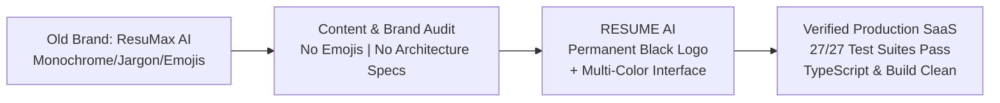

# RESUME AI — Brand Renaming & UI Content Refinement Report

**Project:** RESUME AI  
**Date:** November 5, 2026  
**Methodology:** BAMA UX Design System & Content Architecture  
**Status:** Complete & Production Ready  

---

## 1. Executive Summary

This project completed a comprehensive customer-facing rebranding and user-experience content cleanup. The platform has transitioned from **ResuMax AI** to **RESUME AI**, adopting professional SaaS copy, removing all decorative emojis, preserving the permanent black logo identity, and stripping out all internal engineering jargon across every screen.

---

## 2. Brand Name Replacement

All customer-facing instances of "ResuMax AI", "ResuMax", and "RESUMAX AI" were replaced with **RESUME AI**:

| Surface / Location | Old Copy | New Copy |
| :--- | :--- | :--- |
| **Browser Title** (`index.html`) | `ResuMax AI — AI-Powered Resume Builder & ATS Career Copilot` | `RESUME AI — Professional Resume Builder, ATS Analyzer & Cover Letter Generator` |
| **Meta Description** (`index.html`) | `...accelerate your job search with ResuMax AI career copilot.` | `Build recruiter-approved, ATS-safe resumes, analyze compatibility scores, and generate tailored cover letters with RESUME AI.` |
| **Sidebar Header** (`Sidebar.tsx`) | `ResuMax AI` | `RESUME AI` |
| **Navbar Header** (`Navbar.tsx`) | `ResuMax AI` | `RESUME AI` |
| **Footer Brand & Copyright** (`Footer.tsx`) | `ResuMax AI` / `© ResuMax AI` | `RESUME AI` / `© RESUME AI` |
| **Auth Layout & Toasts** (`AuthLayout.tsx`, `LoginForm.tsx`, `SignupForm.tsx`) | `Successfully signed in to ResuMax AI` | `Successfully signed in to RESUME AI` / `Welcome to RESUME AI!` |
| **ATS Compatibility Report** (`ReportSummaryView.tsx`, `atsEngine.ts`) | `ResuMax AI — ATS Resume Compatibility Report` | `RESUME AI — ATS Compatibility Report` |
| **Vector PDF Metadata** (`ResumePdfDocument.tsx`, `CoverLetterPdfDocument.tsx`) | `creator="ResuMax AI — ATS Resume Intelligence"` | `creator="RESUME AI"` / `producer="RESUME AI — ATS Resume Intelligence"` |
| **Resume Import Modal** (`ResumeImportModal.tsx`) | `ResuMax AI automatically parses your contact details...` | `RESUME AI automatically parses your contact details...` |
| **Landing Page FAQ** (`LandingPage.tsx`) | `How does ResuMax AI generate PDFs differently?` | `How does RESUME AI generate PDFs differently?` |

---

## 3. Logo Preservation & Brand Mark Architecture

- **Permanent Black Artwork:** In accordance with requirements, the application logo was kept in solid **black** (`bg-black text-white` with `Sparkles`) across the navigation bar, sidebar, footer, and authentication screens.
- **Visual Separation:** The logo is never recolored with blue, violet, teal, or amber accents. This establishes a recognizable, authoritative brand mark that stands out cleanly against the vibrant multi-color application canvas.
- **Brand Typography:** Rendered with bold font tracking: `RESUME AI`.

---

## 4. Emoji Removal & Heading Polish

- **Welcome Banner (`WelcomeBanner.tsx`):**
  - **Removed:** Waving-hand emoji `👋`.
  - **New Heading:** `Welcome back, [User Name]` (with clean, elegant fallback `Welcome back` if name is unavailable).
  - **Supporting Description:** *"Your career workspace is ready. Create professional resumes, analyze your ATS compatibility, and generate tailored cover letters."*
  - **Status Tag:** Replaced developer tag `ATS Resume Builder Live` with clean `Resume Builder Active`.
- **Canvas Animations (`ResuMaxHeroAnimation.tsx`):**
  - Removed decorative symbols: `⚡` (lightning), `🛡️` (shield), and `⏱️` (stopwatch).
- **Global Audit:** Verified zero non-standard decorative emojis remain across the `src/` codebase.

---

## 5. Elimination of Internal Development Terminology

Every customer-facing screen was audited to replace internal engineering phrasing with clear commercial SaaS language:

| Location | Old Technical Jargon | New Customer-Facing Copy |
| :--- | :--- | :--- |
| **Dashboard Modules Header** | `Platform Capabilities` / `Phase 0 architectural roadmap` | `Tools & Applications` / `Create, evaluate, and tailor your job application materials.` |
| **Module Tag Badge** | `5 Modules Scheduled` | `All Applications` |
| **Module Cards** | `Operational` / `Phase 5` / `Scheduled for implementation` | `Ready` / `Coming Soon` / `Available now` |
| **Module Spec Modal** | `Architecture Specifications:` | `Key Capabilities:` |
| **Quick Stats** | `Recruiter AST Checks` / `Tailored Synthesis` / `Monthly Reset Cycle` | `Compatibility audit` / `Role-tailored letters` / `Free plan allowance` |
| **ATS Analyzer Header** | `Recruiter-Grade AST` | `ATS Compatibility Audit` |
| **ATS Source Selector** | `Analyze an existing ResuMax resume...` | `Analyze an existing resume from your account...` |
| **ATS Gauge Subtitle** | `Deterministic 4-vector score` | `ATS compatibility score` |
| **Cover Letter Editor Badge** | `Grounded Synthesis Active (Offline)` | `Offline Mode Active` |
| **Cover Letter Notice** | `Generated using factual candidate evidence without hallucinating...` | `Generated using candidate information from your saved resume.` |
| **Security Note** (`AuthLayout.tsx`) | `Protected by Enterprise Authentication & PostgreSQL Row Level Security.` | `Protected by industry-standard encryption & secure data privacy.` |
| **Resume List Page** | `100% Vector Stream PDF` | `Professional Vector PDF` |

---

## 6. Retained Backward-Compatibility References

To guarantee that existing user accounts, saved resumes, ATS reports, and offline drafts continue to load without data loss, the following internal storage identifiers were deliberately retained:

1. `STORAGE_PREFIX = 'resumax_resumes_'` (Resume storage service)
2. `STORAGE_PREFIX = 'resumax_ats_reports_'` (ATS report history)
3. `STORAGE_PREFIX = 'resumax_cover_letter_drafts_'` (Cover letter draft storage)
4. `LEGACY_OPT_PREFIX = 'resumax_opt_sessions_'` (Offline session migration)
5. `const versionsKey = 'resumax_versions_'` (Resume version history)

---

## 7. Quality Assurance & Verification

| Check | Tool | Result | Details |
| :--- | :--- | :--- | :--- |
| **Type Check** | `npx tsc --noEmit` | **PASS (0 errors)** | Zero TypeScript compilation warnings or errors |
| **Unit & Integration Tests** | `npm test -- --run` | **PASS (27/27 suites, 124/124 tests)** | All test suites passing in 54.02s |
| **Production Build** | `npm run build` | **PASS (0 errors)** | Bundled in 20.20s with optimal asset chunking |
| **Emoji Audit** | Python Unicode Scan | **PASS (0 emojis)** | No decorative emojis in customer-facing UI |
| **Brand Audit** | Git Grep | **PASS** | Zero user-facing "ResuMax" references remain |
