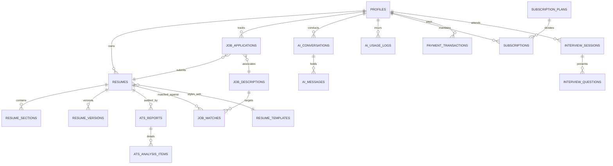

# Normalized Database Architecture Specification — ResuMax AI

**Platform:** PostgreSQL 15+ (Supabase Hosted)  
**Schema Architecture:** Normalized Relational Database with Row Level Security (RLS)  
**Status:** Conceptual Design (Phase 0 Planning — No migrations executed)

---

## 1. Entity-Relationship Overview

---

## 2. Table Specifications (18 Tables)

---

### 1. `profiles`
* **Purpose:** Stores core user profile information linked directly to `auth.users`.
* **Primary Key:** `id` (`UUID`, references `auth.users.id` on delete cascade).
* **Foreign Keys:**
  * `id` -> `auth.users(id)`
* **Important Fields:**
  * `email` (`TEXT`, NOT NULL, UNIQUE)
  * `full_name` (`TEXT`)
  * `headline` (`TEXT`) — e.g., "Senior Full-Stack Engineer"
  * `avatar_url` (`TEXT`)
  * `phone` (`TEXT`)
  * `location` (`TEXT`)
  * `linkedin_url` (`TEXT`)
  * `github_url` (`TEXT`)
  * `portfolio_url` (`TEXT`)
  * `tier` (`TEXT`, DEFAULT `'free'`) — `'free'`, `'pro'`, `'premium'`
  * `created_at` (`TIMESTAMPTZ`, DEFAULT `NOW()`)
  * `updated_at` (`TIMESTAMPTZ`, DEFAULT `NOW()`)
* **Relationships:** One-to-many with `resumes`, `subscriptions`, `ai_usage_logs`, `job_applications`.
* **Indexing:**
  * `CREATE INDEX idx_profiles_email ON profiles(email);`
* **RLS Requirements:**
  * Users can read and update only their own profile (`auth.uid() = id`).
  * System insert triggered automatically upon Supabase Auth signup.

---

### 2. `resumes`
* **Purpose:** Master record for each resume created or uploaded by a user.
* **Primary Key:** `id` (`UUID`, DEFAULT `gen_random_uuid()`).
* **Foreign Keys:**
  * `user_id` -> `profiles(id)` ON DELETE CASCADE
  * `template_id` -> `resume_templates(id)` ON DELETE SET NULL
* **Important Fields:**
  * `title` (`TEXT`, NOT NULL) — e.g., "Full-Stack Engineer Resume 2026"
  * `target_role` (`TEXT`)
  * `summary` (`TEXT`)
  * `is_primary` (`BOOLEAN`, DEFAULT `FALSE`)
  * `ats_score` (`INTEGER`, DEFAULT `0`)
  * `created_at` (`TIMESTAMPTZ`, DEFAULT `NOW()`)
  * `updated_at` (`TIMESTAMPTZ`, DEFAULT `NOW()`)
* **Relationships:** One-to-many with `resume_sections`, `resume_versions`, `ats_reports`, `job_matches`.
* **Indexing:**
  * `CREATE INDEX idx_resumes_user_id ON resumes(user_id);`
  * `CREATE INDEX idx_resumes_updated_at ON resumes(user_id, updated_at DESC);`
* **RLS Requirements:**
  * Full CRUD restricted strictly to the document owner (`auth.uid() = user_id`).

---

### 3. `resume_sections`
* **Purpose:** Stores modular sections of a resume (Work Experience, Education, Projects, Skills) allowing flexible ordering and independent edits.
* **Primary Key:** `id` (`UUID`, DEFAULT `gen_random_uuid()`).
* **Foreign Keys:**
  * `resume_id` -> `resumes(id)` ON DELETE CASCADE
* **Important Fields:**
  * `section_type` (`TEXT`, NOT NULL) — `'personal'`, `'summary'`, `'experience'`, `'education'`, `'skills'`, `'projects'`, `'certifications'`, `'awards'`, `'languages'`
  * `section_title` (`TEXT`, NOT NULL) — e.g., "Professional Experience"
  * `display_order` (`INTEGER`, NOT NULL DEFAULT `0`)
  * `content` (`JSONB`, NOT NULL DEFAULT `'{}'::jsonb`) — Strongly typed structured section records
  * `is_visible` (`BOOLEAN`, DEFAULT `TRUE`)
  * `updated_at` (`TIMESTAMPTZ`, DEFAULT `NOW()`)
* **Relationships:** Belongs to `resumes`.
* **Indexing:**
  * `CREATE INDEX idx_resume_sections_resume_order ON resume_sections(resume_id, display_order ASC);`
  * `CREATE INDEX idx_resume_sections_content_gin ON resume_sections USING GIN (content);`
* **RLS Requirements:**
  * Read/Write allowed only if the parent resume belongs to the user:
    `EXISTS (SELECT 1 FROM resumes WHERE resumes.id = resume_sections.resume_id AND resumes.user_id = auth.uid())`.

---

### 4. `resume_templates`
* **Purpose:** Catalog of available ATS-compliant layout templates.
* **Primary Key:** `id` (`TEXT`) — e.g., `'jakes-classic'`, `'harvard'`, `'stanford'`, `'modern-tech'`.
* **Foreign Keys:** None.
* **Important Fields:**
  * `name` (`TEXT`, NOT NULL)
  * `category` (`TEXT`, NOT NULL) — `'tech'`, `'academic'`, `'executive'`, `'modern'`
  * `description` (`TEXT`)
  * `thumbnail_url` (`TEXT`)
  * `is_pro_only` (`BOOLEAN`, DEFAULT `FALSE`)
  * `config` (`JSONB`, NOT NULL DEFAULT `'{}'::jsonb`) — Font family, margins, heading spacing, accents
  * `created_at` (`TIMESTAMPTZ`, DEFAULT `NOW()`)
* **Relationships:** Referenced by `resumes`.
* **Indexing:**
  * `CREATE INDEX idx_templates_category ON resume_templates(category);`
* **RLS Requirements:**
  * Public read access for authenticated users (`auth.role() = 'authenticated'`).
  * Writes restricted to service-role / admin.

---

### 5. `resume_versions`
* **Purpose:** Point-in-time snapshots for version control, rollback, and historical audit.
* **Primary Key:** `id` (`UUID`, DEFAULT `gen_random_uuid()`).
* **Foreign Keys:**
  * `resume_id` -> `resumes(id)` ON DELETE CASCADE
  * `created_by` -> `profiles(id)` ON DELETE CASCADE
* **Important Fields:**
  * `version_number` (`INTEGER`, NOT NULL)
  * `change_summary` (`TEXT`) — e.g., "Tailored for Google Senior SWE Application"
  * `snapshot` (`JSONB`, NOT NULL) — Full complete serialization of all sections and template state
  * `created_at` (`TIMESTAMPTZ`, DEFAULT `NOW()`)
* **Relationships:** Belongs to `resumes`.
* **Indexing:**
  * `CREATE INDEX idx_versions_resume_num ON resume_versions(resume_id, version_number DESC);`
* **RLS Requirements:**
  * Read/Write restricted to owner of the parent resume.

---

### 6. `ats_reports`
* **Purpose:** Stores comprehensive ATS analysis results for an uploaded or created resume.
* **Primary Key:** `id` (`UUID`, DEFAULT `gen_random_uuid()`).
* **Foreign Keys:**
  * `user_id` -> `profiles(id)` ON DELETE CASCADE
  * `resume_id` -> `resumes(id)` ON DELETE SET NULL
* **Important Fields:**
  * `overall_score` (`INTEGER`, NOT NULL) — 0 to 100
  * `parseability_score` (`INTEGER`, NOT NULL)
  * `impact_score` (`INTEGER`, NOT NULL)
  * `brevity_score` (`INTEGER`, NOT NULL)
  * `style_score` (`INTEGER`, NOT NULL)
  * `skills_score` (`INTEGER`, NOT NULL)
  * `raw_extracted_text` (`TEXT`)
  * `file_name` (`TEXT`)
  * `file_url` (`TEXT`)
  * `created_at` (`TIMESTAMPTZ`, DEFAULT `NOW()`)
* **Relationships:** One-to-many with `ats_analysis_items`.
* **Indexing:**
  * `CREATE INDEX idx_ats_reports_user ON ats_reports(user_id, created_at DESC);`
  * `CREATE INDEX idx_ats_reports_resume ON ats_reports(resume_id);`
* **RLS Requirements:**
  * Restricted to report owner (`auth.uid() = user_id`).

---

### 7. `ats_analysis_items`
* **Purpose:** Granular line-by-line feedback, warnings, and bullet rewrite suggestions.
* **Primary Key:** `id` (`UUID`, DEFAULT `gen_random_uuid()`).
* **Foreign Keys:**
  * `report_id` -> `ats_reports(id)` ON DELETE CASCADE
* **Important Fields:**
  * `category` (`TEXT`, NOT NULL) — `'impact'`, `'parseability'`, `'brevity'`, `'skills'`, `'grammar'`
  * `severity` (`TEXT`, NOT NULL) — `'critical'`, `'warning'`, `'success'`, `'info'`
  * `title` (`TEXT`, NOT NULL) — e.g., "Missing Quantifiable Metrics"
  * `description` (`TEXT`, NOT NULL)
  * `original_text` (`TEXT`)
  * `suggested_fix` (`TEXT`)
  * `is_applied` (`BOOLEAN`, DEFAULT `FALSE`)
* **Relationships:** Belongs to `ats_reports`.
* **Indexing:**
  * `CREATE INDEX idx_analysis_items_report ON ats_analysis_items(report_id);`
* **RLS Requirements:**
  * Inherited from parent `ats_reports` owner.

---

### 8. `job_descriptions`
* **Purpose:** Stores parsed job specifications for matching and tailoring workflows.
* **Primary Key:** `id` (`UUID`, DEFAULT `gen_random_uuid()`).
* **Foreign Keys:**
  * `user_id` -> `profiles(id)` ON DELETE CASCADE
* **Important Fields:**
  * `company_name` (`TEXT`, NOT NULL)
  * `job_title` (`TEXT`, NOT NULL)
  * `job_url` (`TEXT`)
  * `raw_text` (`TEXT`, NOT NULL)
  * `required_skills` (`TEXT[]`, DEFAULT `'{}'::text[]`)
  * `preferred_skills` (`TEXT[]`, DEFAULT `'{}'::text[]`)
  * `keywords` (`TEXT[]`, DEFAULT `'{}'::text[]`)
  * `created_at` (`TIMESTAMPTZ`, DEFAULT `NOW()`)
* **Relationships:** One-to-many with `job_matches` and `job_applications`.
* **Indexing:**
  * `CREATE INDEX idx_job_descriptions_user ON job_descriptions(user_id);`
  * `CREATE INDEX idx_job_descriptions_skills_gin ON job_descriptions USING GIN (required_skills);`
* **RLS Requirements:**
  * Restricted to creating user (`auth.uid() = user_id`).

---

### 9. `job_matches`
* **Purpose:** Stores semantic match scores between a specific resume and job description.
* **Primary Key:** `id` (`UUID`, DEFAULT `gen_random_uuid()`).
* **Foreign Keys:**
  * `user_id` -> `profiles(id)` ON DELETE CASCADE
  * `resume_id` -> `resumes(id)` ON DELETE CASCADE
  * `job_description_id` -> `job_descriptions(id)` ON DELETE CASCADE
* **Important Fields:**
  * `match_percentage` (`INTEGER`, NOT NULL) — 0 to 100
  * `matched_skills` (`TEXT[]`, DEFAULT `'{}'::text[]`)
  * `missing_hard_skills` (`TEXT[]`, DEFAULT `'{}'::text[]`)
  * `missing_soft_skills` (`TEXT[]`, DEFAULT `'{}'::text[]`)
  * `tailoring_recommendations` (`JSONB`, DEFAULT `'[]'::jsonb`)
  * `created_at` (`TIMESTAMPTZ`, DEFAULT `NOW()`)
* **Relationships:** Belongs to `resumes` and `job_descriptions`.
* **Indexing:**
  * `CREATE INDEX idx_job_matches_resume_job ON job_matches(resume_id, job_description_id);`
* **RLS Requirements:**
  * Restricted to user (`auth.uid() = user_id`).

---

### 10. `job_applications`
* **Purpose:** Tracks application status in a Kanban/list workflow linked to tailored resumes.
* **Primary Key:** `id` (`UUID`, DEFAULT `gen_random_uuid()`).
* **Foreign Keys:**
  * `user_id` -> `profiles(id)` ON DELETE CASCADE
  * `job_description_id` -> `job_descriptions(id)` ON DELETE SET NULL
  * `tailored_resume_id` -> `resumes(id)` ON DELETE SET NULL
* **Important Fields:**
  * `company_name` (`TEXT`, NOT NULL)
  * `position_title` (`TEXT`, NOT NULL)
  * `status` (`TEXT`, NOT NULL DEFAULT `'saved'`) — `'saved'`, `'applied'`, `'interviewing'`, `'offered'`, `'rejected'`
  * `applied_date` (`DATE`)
  * `salary_range` (`TEXT`)
  * `cover_letter_text` (`TEXT`)
  * `notes` (`TEXT`)
  * `created_at` (`TIMESTAMPTZ`, DEFAULT `NOW()`)
  * `updated_at` (`TIMESTAMPTZ`, DEFAULT `NOW()`)
* **Relationships:** Belongs to `profiles`.
* **Indexing:**
  * `CREATE INDEX idx_applications_user_status ON job_applications(user_id, status);`
* **RLS Requirements:**
  * Restricted to applicant (`auth.uid() = user_id`).

---

### 11. `interview_sessions`
* **Purpose:** Holds mock interview simulations and preparation sessions.
* **Primary Key:** `id` (`UUID`, DEFAULT `gen_random_uuid()`).
* **Foreign Keys:**
  * `user_id` -> `profiles(id)` ON DELETE CASCADE
  * `job_application_id` -> `job_applications(id)` ON DELETE SET NULL
* **Important Fields:**
  * `session_type` (`TEXT`, NOT NULL) — `'technical'`, `'system_design'`, `'behavioral'`, `'hr'`
  * `target_role` (`TEXT`, NOT NULL)
  * `overall_score` (`INTEGER`) — 0 to 100
  * `feedback_summary` (`TEXT`)
  * `status` (`TEXT`, DEFAULT `'in_progress'`) — `'in_progress'`, `'completed'`, `'abandoned'`
  * `created_at` (`TIMESTAMPTZ`, DEFAULT `NOW()`)
* **Relationships:** One-to-many with `interview_questions`.
* **Indexing:**
  * `CREATE INDEX idx_interview_sessions_user ON interview_sessions(user_id);`
* **RLS Requirements:**
  * Restricted to user (`auth.uid() = user_id`).

---

### 12. `interview_questions`
* **Purpose:** Individual questions, user answers, and AI grading in an interview session.
* **Primary Key:** `id` (`UUID`, DEFAULT `gen_random_uuid()`).
* **Foreign Keys:**
  * `session_id` -> `interview_sessions(id)` ON DELETE CASCADE
* **Important Fields:**
  * `question_text` (`TEXT`, NOT NULL)
  * `category` (`TEXT`, NOT NULL) — e.g., `'STAR_Leadership'`, `'Distributed_Caching'`
  * `difficulty` (`TEXT`) — `'junior'`, `'mid'`, `'senior'`, `'staff'`
  * `user_answer` (`TEXT`)
  * `ai_critique` (`TEXT`)
  * `model_answer` (`TEXT`)
  * `score` (`INTEGER`) — 0 to 100
* **Relationships:** Belongs to `interview_sessions`.
* **Indexing:**
  * `CREATE INDEX idx_interview_questions_session ON interview_questions(session_id);`
* **RLS Requirements:**
  * Inherited from parent session owner.

---

### 13. `ai_conversations`
* **Purpose:** Manages career copilot ("Atlas / Max") conversational threads.
* **Primary Key:** `id` (`UUID`, DEFAULT `gen_random_uuid()`).
* **Foreign Keys:**
  * `user_id` -> `profiles(id)` ON DELETE CASCADE
  * `resume_id` -> `resumes(id)` ON DELETE SET NULL
* **Important Fields:**
  * `title` (`TEXT`, NOT NULL DEFAULT `'Career Consultation'`)
  * `context_scope` (`TEXT`, DEFAULT `'general'`) — `'general'`, `'resume_edit'`, `'interview_prep'`, `'salary_negotiation'`
  * `created_at` (`TIMESTAMPTZ`, DEFAULT `NOW()`)
  * `updated_at` (`TIMESTAMPTZ`, DEFAULT `NOW()`)
* **Relationships:** One-to-many with `ai_messages`.
* **Indexing:**
  * `CREATE INDEX idx_conversations_user ON ai_conversations(user_id, updated_at DESC);`
* **RLS Requirements:**
  * Restricted to user (`auth.uid() = user_id`).

---

### 14. `ai_messages`
* **Purpose:** Individual chat turns between user and AI career copilot.
* **Primary Key:** `id` (`UUID`, DEFAULT `gen_random_uuid()`).
* **Foreign Keys:**
  * `conversation_id` -> `ai_conversations(id)` ON DELETE CASCADE
* **Important Fields:**
  * `role` (`TEXT`, NOT NULL) — `'user'`, `'assistant'`, `'system'`
  * `content` (`TEXT`, NOT NULL)
  * `suggested_actions` (`JSONB`, DEFAULT `'[]'::jsonb`) — Inline clickable chips (e.g. "Apply to resume")
  * `created_at` (`TIMESTAMPTZ`, DEFAULT `NOW()`)
* **Relationships:** Belongs to `ai_conversations`.
* **Indexing:**
  * `CREATE INDEX idx_ai_messages_convo ON ai_messages(conversation_id, created_at ASC);`
* **RLS Requirements:**
  * Inherited from conversation owner.

---

### 15. `ai_usage_logs`
* **Purpose:** Enforces monthly subscription quotas and tracks token consumption.
* **Primary Key:** `id` (`UUID`, DEFAULT `gen_random_uuid()`).
* **Foreign Keys:**
  * `user_id` -> `profiles(id)` ON DELETE CASCADE
* **Important Fields:**
  * `action_type` (`TEXT`, NOT NULL) — `'bullet_optimize'`, `'ats_score'`, `'job_tailor'`, `'copilot_turn'`, `'interview_eval'`
  * `provider` (`TEXT`, NOT NULL) — `'gemini'`, `'openai'`, `'claude'`, `'ollama'`
  * `model_name` (`TEXT`, NOT NULL) — e.g., `'gemini-1.5-flash'`, `'gpt-4o-mini'`
  * `prompt_tokens` (`INTEGER`, DEFAULT `0`)
  * `completion_tokens` (`INTEGER`, DEFAULT `0`)
  * `total_tokens` (`INTEGER`, DEFAULT `0`)
  * `billing_cycle_month` (`TEXT`, NOT NULL) — e.g., `'2026-11'`
  * `created_at` (`TIMESTAMPTZ`, DEFAULT `NOW()`)
* **Relationships:** Belongs to `profiles`.
* **Indexing:**
  * `CREATE INDEX idx_usage_user_cycle ON ai_usage_logs(user_id, billing_cycle_month);`
  * `CREATE INDEX idx_usage_action_type ON ai_usage_logs(user_id, action_type);`
* **RLS Requirements:**
  * User can read their own logs (`auth.uid() = user_id`).
  * Only server-side Edge Functions / service-role can insert records.

---

### 16. `subscription_plans`
* **Purpose:** Defines billing tiers, price points, and quota entitlements.
* **Primary Key:** `id` (`TEXT`) — `'free'`, `'pro_monthly'`, `'pro_yearly'`, `'premium_monthly'`, `'premium_yearly'`.
* **Foreign Keys:** None.
* **Important Fields:**
  * `name` (`TEXT`, NOT NULL)
  * `tier` (`TEXT`, NOT NULL) — `'free'`, `'pro'`, `'premium'`
  * `price_cents` (`INTEGER`, NOT NULL) — e.g., `2900` for $29.00
  * `billing_interval` (`TEXT`, NOT NULL) — `'month'`, `'year'`
  * `stripe_price_id` (`TEXT`)
  * `quota_resumes` (`INTEGER`, NOT NULL) — e.g., 3, 50, 9999
  * `quota_ats_scans` (`INTEGER`, NOT NULL) — e.g., 1, 25, 100
  * `quota_tailoring` (`INTEGER`, NOT NULL) — e.g., 3, 30, 150
  * `quota_copilot_daily_turns` (`INTEGER`, NOT NULL) — e.g., 0, 50, 200
  * `is_active` (`BOOLEAN`, DEFAULT `TRUE`)
* **Relationships:** One-to-many with `subscriptions`.
* **Indexing:**
  * `CREATE INDEX idx_plans_tier ON subscription_plans(tier, is_active);`
* **RLS Requirements:**
  * Public read access for authenticated users.

---

### 17. `subscriptions`
* **Purpose:** Active billing subscriptions linked to Stripe customer IDs.
* **Primary Key:** `id` (`UUID`, DEFAULT `gen_random_uuid()`).
* **Foreign Keys:**
  * `user_id` -> `profiles(id)` ON DELETE CASCADE
  * `plan_id` -> `subscription_plans(id)` ON DELETE RESTRICT
* **Important Fields:**
  * `stripe_customer_id` (`TEXT`, UNIQUE)
  * `stripe_subscription_id` (`TEXT`, UNIQUE)
  * `status` (`TEXT`, NOT NULL) — `'active'`, `'trialing'`, `'past_due'`, `'canceled'`, `'incomplete'`
  * `current_period_start` (`TIMESTAMPTZ`, NOT NULL)
  * `current_period_end` (`TIMESTAMPTZ`, NOT NULL)
  * `cancel_at_period_end` (`BOOLEAN`, DEFAULT `FALSE`)
  * `created_at` (`TIMESTAMPTZ`, DEFAULT `NOW()`)
* **Relationships:** Belongs to `profiles` and `subscription_plans`.
* **Indexing:**
  * `CREATE INDEX idx_subscriptions_user ON subscriptions(user_id);`
  * `CREATE INDEX idx_subscriptions_stripe ON subscriptions(stripe_subscription_id);`
* **RLS Requirements:**
  * Users can read their own subscription (`auth.uid() = user_id`).
  * Mutations restricted to Stripe Webhook Edge Function (service-role).

---

### 18. `payment_transactions`
* **Purpose:** Audit ledger of individual charges, invoices, and refunds.
* **Primary Key:** `id` (`UUID`, DEFAULT `gen_random_uuid()`).
* **Foreign Keys:**
  * `user_id` -> `profiles(id)` ON DELETE CASCADE
  * `subscription_id` -> `subscriptions(id)` ON DELETE SET NULL
* **Important Fields:**
  * `stripe_invoice_id` (`TEXT`, UNIQUE)
  * `amount_cents` (`INTEGER`, NOT NULL)
  * `currency` (`TEXT`, DEFAULT `'usd'`)
  * `status` (`TEXT`, NOT NULL) — `'succeeded'`, `'failed'`, `'refunded'`
  * `receipt_url` (`TEXT`)
  * `created_at` (`TIMESTAMPTZ`, DEFAULT `NOW()`)
* **Relationships:** Belongs to `profiles`.
* **Indexing:**
  * `CREATE INDEX idx_transactions_user ON payment_transactions(user_id, created_at DESC);`
* **RLS Requirements:**
  * User can read their own receipts. Mutations restricted to service-role.
