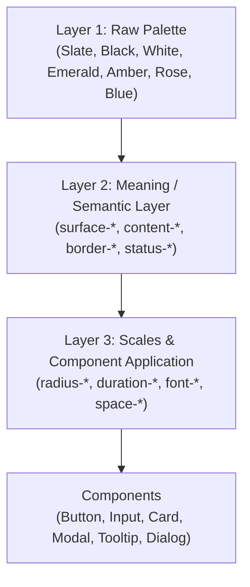

# ResuMax AI — Design System & Tokens Specification

**Methodology:** BAMA `design-system` & `design-kit`  
**Version:** 1.0.0  
**Stack:** Tailwind CSS, React 18, TypeScript  

---

## 1. Design Token Architecture (Three Layers)

Following the BAMA design-kit methodology, all visual attributes are organized into three layers:

1. **Palette (Raw):** Deep slate-900, pitch black, crisp white, off-white slate-50, and four functional accents.
2. **Meaning (Semantic):** Component-facing names (`surface-base`, `content-primary`, `border-default`, `status-success`).
3. **Scales (Metrics):** Standardized scales for radius, spacing, typography, and motion.

---

## 2. Color System & WCAG AA Contrast

| Token | Class / Hex | Intended Purpose | Contrast on White |
| :--- | :--- | :--- | :--- |
| `surface-base` | `#ffffff` | Primary background for cards, modals, sheets | N/A |
| `surface-raised` | `#f8fafc` | Page canvas, secondary containers | N/A |
| `surface-subtle` | `#f1f5f9` | Tag pills, inactive tabs, dividers | N/A |
| `content-primary` | `#0f172a` | Headers, labels, primary text | **16.1 : 1** (AAA) |
| `content-secondary`| `#334155` | Body descriptions, form field values | **10.5 : 1** (AAA) |
| `content-muted` | `#64748b` | Timestamps, helper notes, breadcrumb links | **4.6 : 1** (AA $\ge 4.5:1$) |
| `border-default` | `#e2e8f0` | Standard card and input stroke | Distinct structural boundary |
| `border-strong` | `#94a3b8` | Active or hover borders | High-visibility separation |
| `status-success` | `#059669` | Cloud sync verified, high ATS score | **4.6 : 1** (AA) |
| `status-warning` | `#d97706` | Formatting warnings, draft unsaved alert | High visibility on warning light |
| `status-error` | `#e11d48` | Validation errors, failed imports | **4.7 : 1** (AA) |
| `status-info` | `#2563eb` | ATS tips, helpful context callouts | High visibility on info light |

---

## 3. Radius Scale (5-Step Hierarchy)

Concentric radii ensure nested elements feel balanced ($R_{\text{inner}} = R_{\text{outer}} - \text{padding}$):

| Step | Token | Radius Value | Applied Components |
| :--- | :--- | :--- | :--- |
| **xs** | `rounded-radius-xs` | `4px` | Badges, micro tags, status dots, tooltips |
| **sm** | `rounded-radius-sm` | `8px` | Buttons, form inputs, select dropdowns, action chips |
| **md** | `rounded-radius-md` | `12px` | Inner cards, accordion items, list cards, table containers |
| **lg** | `rounded-radius-lg` | `16px` | Section cards, preview containers, sheets, dialogs |
| **xl** | `rounded-radius-xl` | `24px` | Hero upload dropzones, major layout panels, banner frames |

---

## 4. Typography Scale

- **Display:** `text-2xl` / `text-3xl` (`font-bold font-sans tracking-tight text-slate-900`)
- **Title:** `text-lg` / `text-xl` (`font-bold text-slate-900 leading-snug`)
- **Headline / Section Header:** `text-sm` (`font-bold text-slate-900 uppercase tracking-wider`)
- **Body:** `text-sm` (`font-normal text-slate-700 leading-relaxed`)
- **Subtext:** `text-xs` (`font-normal text-slate-500 leading-normal`)
- **Meta / Micro:** `text-[11px]` (`font-medium text-slate-500 font-mono`)

---

## 5. Motion & Accessibility

- **Duration Tokens:**
  - `duration-quick` (`100ms`): Button press, checkbox toggle, hover highlight.
  - `duration-standard` (`150ms`): Tooltips, dropdown menu expands, tab switches.
  - `duration-smooth` (`200ms`): Modal backdrop fade, drawer slide, panel transition.
- **Prefers-Reduced-Motion:** Enabled globally via CSS media query to protect users sensitive to motion.
- **Focus Indicator:** All interactive elements feature a high-contrast 2px ring (`focus-visible:ring-2 focus-visible:ring-slate-900 focus-visible:ring-offset-2`).
- **Touch Target:** Minimum $44 \times 44\text{px}$ touch area for mobile interactive controls.
