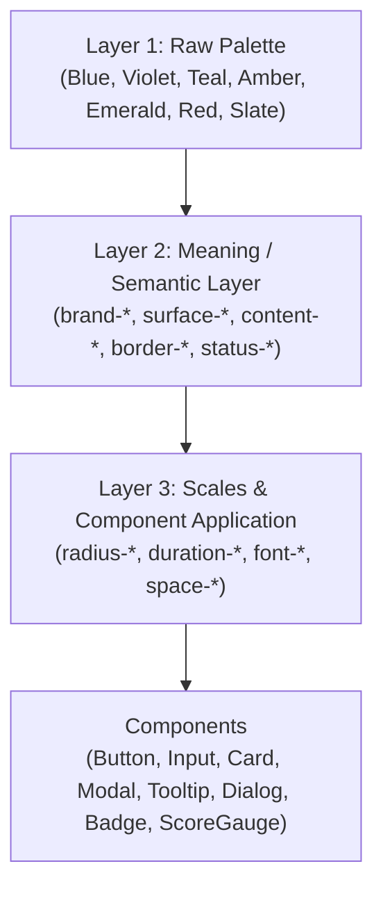

# ResuMax AI — Design System & Tokens Specification

**Methodology:** BAMA `design-system` & `design-kit`  
**Visual Identity:** Modern Multi-Color SaaS (Blue + Violet + Teal + Amber)  
**Version:** 2.0.0  
**Stack:** Tailwind CSS, React 18, TypeScript  

---

## 1. Design Token Architecture (Three Layers)

Following the BAMA design-kit methodology, all visual attributes are organized into three layers:

1. **Palette (Raw):** Primary Blue (`#2563EB`), Secondary Violet (`#7C3AED`), Teal (`#0D9488`), Amber (`#F59E0B`), Success (`#16A34A`), Error (`#DC2626`), Slate scale.
2. **Meaning (Semantic):** Component-facing names (`surface-base`, `content-primary`, `border-default`, `status-success`, feature accents).
3. **Scales (Metrics):** Standardized scales for radius, spacing, typography, and motion.

---

## 2. Brand & Semantic Multi-Color Palette

| Role / Feature | Token | Hex | Intended Purpose | Contrast on White |
| :--- | :--- | :--- | :--- | :--- |
| **Primary Brand / Resume Builder** | `brand-primary` | `#2563EB` | Primary buttons, active tabs, resume editor accents | **4.6 : 1** (AA) |
| **Primary Hover** | `brand-primary-hover`| `#1D4ED8` | Hover/active states on primary actions | **6.4 : 1** (AAA) |
| **Secondary / ATS Analyzer** | `brand-secondary` | `#7C3AED` | ATS scanner hero gauges, history cards, audit pills | **5.4 : 1** (AA) |
| **Accent / Cover Letter** | `brand-teal` | `#0D9488` | Cover letter generator CTA, tone selector, draft states | **4.7 : 1** (AA) |
| **Quota / Highlights** | `brand-amber` | `#F59E0B` | AI quota warnings, career copilot badges | High visibility on light tints |
| **Success** | `status-success` | `#16A34A` | High ATS score ($\ge 80$), cloud save verified | **4.5 : 1** (AA) |
| **Warning** | `status-warning` | `#D97706` | Medium ATS score ($60-79$), formatting notices | **4.6 : 1** (AA) |
| **Error** | `status-error` | `#DC2626` | Low ATS score ($< 60$), validation errors, delete | **4.8 : 1** (AA) |

### Surface & Canvas Tokens

| Token | Hex | Usage |
| :--- | :--- | :--- |
| `surface-canvas` | `#F4F7FC` | Main application background (soft blue-gray canvas) |
| `surface-base` | `#FFFFFF` | Primary elevated cards, modals, dropdowns |
| `surface-subtle` | `#F8FAFC` | Secondary panels, preview backgrounds, sidebar profile |
| `tint-blue` | `#E8EEFF` | Blue feature container background & active hover |
| `tint-violet` | `#F1EAFF` | ATS analyzer container background & gauge base |
| `tint-teal` | `#CCFBF1` | Cover letter container background & selected tone |
| `tint-amber` | `#FEF3C7` | Warning notices, quota alerts |

---

## 3. Radius Scale (5-Step Hierarchy)

Concentric radii ensure nested elements feel balanced ($R_{\text{inner}} = R_{\text{outer}} - \text{padding}$):

| Step | Token | Radius Value | Applied Components |
| :--- | :--- | :--- | :--- |
| **xs** | `rounded-radius-xs` | `4px` | Badges, micro tags, status dots, tooltips |
| **sm** | `rounded-radius-sm` | `8px` | Buttons, form inputs, select dropdowns, action chips |
| **md** | `rounded-radius-md` | `12px` | Inner cards, accordion items, list cards, table containers |
| **lg** | `rounded-radius-lg` | `16px` | Section cards, preview containers, sheets, dialogs |
| **xl** | `rounded-radius-xl` | `24px` | Hero upload dropzones, major layout panels, banner frames |

---

## 4. Typography Scale

- **Display:** `text-2xl` / `text-3xl` (`font-black tracking-tight text-slate-900`)
- **Title:** `text-lg` / `text-xl` (`font-bold text-slate-900 leading-snug`)
- **Headline / Section Header:** `text-sm` (`font-bold text-slate-900 uppercase tracking-wider`)
- **Body:** `text-sm` (`font-normal text-slate-700 leading-relaxed`)
- **Subtext:** `text-xs` (`font-normal text-slate-500 leading-normal`)
- **Meta / Micro:** `text-[11px]` (`font-medium text-slate-500 font-mono`)

---

## 5. Component Variants

### Button Variants
- `primary`: Blue (`#2563EB`) with soft blue shadow (`shadow-blue-500/20`).
- `violet`: Secondary Violet (`#7C3AED`) with violet shadow (`shadow-violet-500/20`).
- `teal`: Accent Teal (`#0D9488`) with teal shadow (`shadow-teal-500/20`).
- `outline`: Neutral border with subtle Blue tint hover (`hover:bg-blue-50/70 hover:text-blue-700`).
- `ghost`: Transparent with subtle Blue hover (`hover:bg-blue-50/70 hover:text-blue-700`).
- `danger`: Red (`#DC2626`) with soft red shadow.

### Badge Variants
- `default`: Neutral slate pill.
- `brand`: Blue pill (`bg-blue-50 text-blue-700 border-blue-200`).
- `violet`: Violet pill (`bg-violet-50 text-violet-700 border-violet-200`).
- `teal`: Teal pill (`bg-teal-50 text-teal-700 border-teal-200`).
- `amber`: Amber pill (`bg-amber-50 text-amber-800 border-amber-200`).
- `success`: Emerald pill (`bg-emerald-50 text-emerald-800 border-emerald-200`).
- `warning`: Amber pill (`bg-amber-50 text-amber-800 border-amber-200`).
- `danger`: Red pill (`bg-red-50 text-red-700 border-red-200`).

---

## 6. Motion & Accessibility

- **Duration Tokens:**
  - `duration-quick` (`100ms`): Button press, checkbox toggle, hover highlight.
  - `duration-standard` (`150ms`): Tooltips, dropdown menu expands, tab switches.
  - `duration-smooth` (`200ms`): Modal backdrop fade, drawer slide, panel transition.
- **Prefers-Reduced-Motion:** Enabled globally via CSS media query to protect users sensitive to motion.
- **Focus Indicator:** All interactive elements feature a high-contrast 2px ring (`focus-visible:ring-2 focus-visible:ring-blue-600 focus-visible:ring-offset-2`).
- **Touch Target:** Minimum $44 \times 44\text{px}$ touch area for mobile interactive controls.

