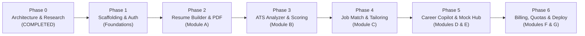

# Development Roadmap & Multi-Phase Execution Plan — ResuMax AI

**Current Status:** Phase 0 Completed (Planning & Architecture)  
**Execution Methodology:** Iterative Mileposted Delivery with Strict Quality Gates

---

## 1. Roadmap Overview & Timeline

---

## 2. Phase-by-Phase Deliverables & Quality Gates

### Phase 0: Project Foundation, Research & Architecture (CURRENT)
* **Status:** **COMPLETED**
* **Key Deliverables:**
  * Created independent project root `D:\RESUMAX_AI` with initial Git repository.
  * Verified untouched read-only status of legacy `ResumeForge AI` project (`D:\resumeforge-ai-firebase\resumeforge`).
  * Researched reference platform (`https://resumax.ai/home`) and extracted competitive design/pricing patterns.
  * Authored complete architectural documentation suite (PRD, System Architecture, Database Design, Security, AI Agents, Roadmap).
* **Quality Gate:** Operator review and formal sign-off before commencing Phase 1.

---

### Phase 1: Project Scaffolding, Core Infrastructure & Design System
* **Scope:**
  * Initialize Vite + React 18/19 + TypeScript template.
  * Configure Tailwind CSS with custom ResuMax design tokens (fonts, slate/emerald/cyan palette, dark/light mode).
  * Setup Lucide React iconography and base component library (Button, Input, Modal, Badge, Card, Toast).
  * Setup Supabase client library with TypeScript database type definitions.
  * Implement Supabase Auth UI (Login, Signup, Forgot Password) with PKCE session persistence.
  * Configure Zustand stores (`useResumeStore`, `useAuthStore`, `useUIStore`).
* **Quality Gate:** TypeScript clean compile (`tsc --noEmit`), ESLint passing with zero warnings, Auth signup/login verified in browser.

---

### Phase 2: Core AI Resume Builder & Vector PDF Engine (Module A)
* **Scope:**
  * Build responsive live split-screen resume editor with tabbed/accordion section navigation.
  * Implement 4 ATS-compliant templates:
    1. *Jake's Technical Standard* (Single-column Overleaf-style).
    2. *Harvard Classic* (Traditional serif).
    3. *Stanford Editorial* (Executive blue accent).
    4. *Modern Tech Clean* (Balanced tech badge layout).
  * Implement debounced auto-save (800ms) to Supabase PostgreSQL (`resumes` & `resume_sections`).
  * Integrate `@react-pdf/renderer` generating 100% vector-based, searchable text-stream PDFs.
  * Implement `.docx` export utility using `docx` package.
* **Quality Gate:** Exported PDF passes automated text selection, copy-paste integrity, and ATS parser test without missing characters.

---

### Phase 3: ATS Resume Analyzer & Bullet Optimizer (Module B)
* **Scope:**
  * Build drag-and-drop file uploader supporting `.pdf` and `.docx` (max 5MB).
  * Implement client/edge text extraction converting document streams into structured JSON AST.
  * Build 5-vector ATS scoring algorithm (Parseability, Impact, Brevity, Style, Skills) outputting 0–100 scores.
  * Create interactive score visualization with radial progress dials and diagnostic cards (Red/Yellow/Green).
  * Build inline AI Bullet Optimizer utilizing Google's XYZ formula via Supabase Edge Function (`ai-gateway`).
* **Quality Gate:** Uploading standard test resumes generates deterministic scores and actionable rewrite recommendations.

---

### Phase 4: Job Matching, Resume Tailoring & Application Tracking (Module C)
* **Scope:**
  * Implement Job Description parser extracting hard/soft skills and seniority requirements.
  * Calculate semantic match percentage and missing keyword matrix.
  * Build one-click "Tailor Resume" workflow that creates a targeted version of the user's resume.
  * Build AI Cover Letter Generator based on verified candidate profile.
  * Implement Kanban Job Application Tracker (`Saved`, `Applied`, `Interviewing`, `Offered`, `Rejected`) linking applications to tailored resumes.
* **Quality Gate:** Tailored resumes weave missing keywords into appropriate experience sections without inventing false credentials.

---

### Phase 5: "Max" AI Career Copilot & Interview Prep Hub (Modules D & E)
* **Scope:**
  * Implement conversational slide-out drawer ("Max") with streaming Markdown responses.
  * Ground chat context on user's active resume and career goals.
  * Build Interview Preparation Hub with role-specific technical question generator (Data Structures, System Design, STAR Behavioral).
  * Implement interactive mock interview practice mode with AI feedback and scoring.
* **Quality Gate:** Copilot reliably answers career queries and generates relevant interview questions grounded in the user's specific tech stack.

---

### Phase 6: Subscriptions, Quota Enforcement & Production Launch (Modules F & G)
* **Scope:**
  * Implement user dashboard consolidating resumes, ATS reports, and active job applications.
  * Integrate Stripe Checkout and Customer Billing Portal for Free ($0), Pro ($29/mo), and Premium ($49/mo) plans.
  * Implement server-side quota enforcement via PostgreSQL triggers / Edge Functions before servicing LLM calls.
  * Build Netlify deployment pipeline with automated preview branches and security headers.
  * Conduct final penetration testing, accessibility review (WCAG 2.1 AA), and end-to-end user regression tests.
* **Quality Gate:** End-to-end checkout, quota limit enforcement, and public production deployment successfully verified.
