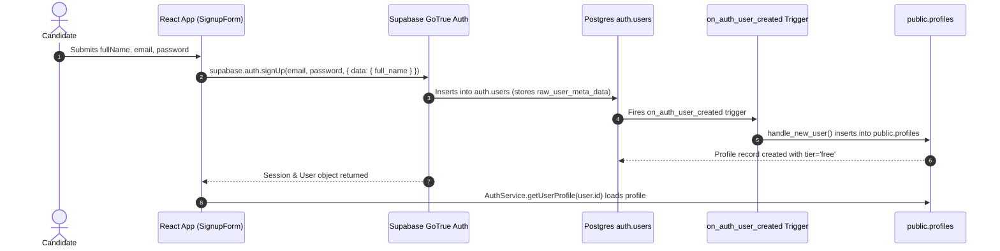

# ResuMax AI — Phase 2 Remote Database Migration Readiness

**Project:** `D:\RESUMAX_AI`  
**Branch:** `feature/phase-2-resume-builder`  
**Current Phase:** Phase 2 Remote Database Readiness  
**Validation Mode:** Static schema review, typecheck, unit tests, and production build (Zero remote mutations executed)  
**Date:** November 3, 2026  

---

## 1. Executive Summary

This document specifies the ordered database migration architecture required to transition **ResuMax AI** from local fallback persistence to a fully synchronized Supabase PostgreSQL database with Row Level Security (RLS).

The prior dependency blocker — wherein Phase 2 resume tables referenced `public.profiles(id)` before `public.profiles` existed — has been resolved by decomposing the schema into two timestamped, dependency-ordered migrations:
1. `supabase/migrations/20261101000000_create_profiles_schema.sql` (Phase 1 Foundations: Profiles, Auth trigger, updated_at helper, and profile RLS).
2. `supabase/migrations/20261102000000_create_resumes_schema.sql` (Phase 2 Resume Builder: Templates catalog, Master resumes, Normalized sections, Version snapshots, unique constraints, and hierarchical RLS).

Both migrations have been statically reviewed, validated against application TypeScript types and `ResumeService` queries, and verified locally with clean typecheck, 70/70 passing automated tests, and a production build.

---

## 2. Migration Filenames and Application Order

Migrations **must** be executed sequentially:

```
Step 1: 20261101000000_create_profiles_schema.sql
   └── Creates public.handle_updated_at() helper
   └── Creates public.profiles (references auth.users.id)
   └── Attaches on_auth_user_created trigger on auth.users
   └── Configures strict profiles RLS

Step 2: 20261102000000_create_resumes_schema.sql
   └── Creates public.resume_templates & seeds 4 standard templates
   └── Creates public.resumes (references public.profiles.id)
   └── Creates public.resume_sections (references public.resumes.id with composite unique constraint)
   └── Creates public.resume_versions (references public.resumes.id and public.profiles.id)
   └── Attaches updated_at triggers
   └── Configures document-level and child-level RLS policies
```

---

## 3. Database Object Specifications

### 3.1 Migration 1: `20261101000000_create_profiles_schema.sql`

#### Table: `public.profiles`
| Column | Type | Constraints / Defaults | Description |
| :--- | :--- | :--- | :--- |
| `id` | `UUID` | `PRIMARY KEY REFERENCES auth.users(id) ON DELETE CASCADE` | 1-to-1 link to Supabase Auth |
| `email` | `TEXT` | `NOT NULL` | User email address |
| `full_name` | `TEXT` | `NULL` | Full candidate name |
| `headline` | `TEXT` | `NULL` | Professional title / headline |
| `avatar_url` | `TEXT` | `NULL` | Avatar profile image URL |
| `phone` | `TEXT` | `NULL` | Contact phone number |
| `location` | `TEXT` | `NULL` | City, State/Country |
| `linkedin_url` | `TEXT` | `NULL` | LinkedIn profile URL |
| `github_url` | `TEXT` | `NULL` | GitHub profile URL |
| `portfolio_url` | `TEXT` | `NULL` | Personal portfolio / website URL |
| `tier` | `TEXT` | `NOT NULL DEFAULT 'free' CHECK (tier IN ('free', 'pro', 'premium'))` | Account subscription tier |
| `created_at` | `TIMESTAMPTZ` | `NOT NULL DEFAULT NOW()` | Record creation timestamp |
| `updated_at` | `TIMESTAMPTZ` | `NOT NULL DEFAULT NOW()` | Last modification timestamp |

#### Indexes, Triggers, and Functions:
- **Index:** `idx_profiles_email ON public.profiles(email)` (B-Tree).
- **Function:** `public.handle_updated_at()` — Shared trigger function updating `NEW.updated_at = NOW()`.
- **Trigger:** `trigger_profiles_updated_at` — Fires `BEFORE UPDATE ON public.profiles`.
- **Auth Trigger Function:** `public.handle_new_user()` — Executed as `SECURITY DEFINER SET search_path = public`. Automatically extracts `NEW.id`, `NEW.email`, and `NEW.raw_user_meta_data->>'full_name'` to insert or update `public.profiles`.
- **Auth Trigger:** `on_auth_user_created` — Fires `AFTER INSERT ON auth.users`.
- **Backfill Query:** Idempotent insert copying any pre-existing `auth.users` into `public.profiles` using `ON CONFLICT (id) DO NOTHING`.

#### Row Level Security (RLS) Policies on `public.profiles`:
- `ENABLE ROW LEVEL SECURITY` active.
- **SELECT:** `Users can view their own profile` — `auth.uid() = id` (authenticated).
- **INSERT:** `Users can insert their own profile` — `WITH CHECK (auth.uid() = id)` (authenticated).
- **UPDATE:** `Users can update their own profile` — `USING (auth.uid() = id) WITH CHECK (auth.uid() = id)` (authenticated).

---

### 3.2 Migration 2: `20261102000000_create_resumes_schema.sql`

#### Table: `public.resume_templates`
- **Columns:** `id TEXT PRIMARY KEY`, `name TEXT NOT NULL`, `category TEXT NOT NULL CHECK (...)`, `description TEXT`, `thumbnail_url TEXT`, `is_pro_only BOOLEAN NOT NULL DEFAULT FALSE`, `config JSONB NOT NULL DEFAULT '{}'::jsonb`, `created_at TIMESTAMPTZ NOT NULL DEFAULT NOW()`.
- **Catalog Seeds:**
  1. `jakes-technical` (Tech single-column layout)
  2. `harvard-classic` (Academic serif layout)
  3. `stanford-editorial` (Modern editorial hierarchy)
  4. `modern-tech-clean` (Contemporary tech layout)
- **RLS:** `Templates are viewable by all users` for `SELECT USING (TRUE)` (Public read catalog; write restricted to service-role).

#### Table: `public.resumes`
- **Columns:**
  - `id UUID PRIMARY KEY DEFAULT gen_random_uuid()`
  - `user_id UUID NOT NULL REFERENCES public.profiles(id) ON DELETE CASCADE`
  - `title TEXT NOT NULL DEFAULT 'Untitled Resume'`
  - `target_role TEXT NULL`
  - `summary TEXT NULL`
  - `template_id TEXT NOT NULL REFERENCES public.resume_templates(id) DEFAULT 'jakes-technical'`
  - `customization JSONB NOT NULL DEFAULT '{ "accentColor": "#0f172a", "fontFamily": "Inter", ... }'::jsonb`
  - `personal_info JSONB NOT NULL DEFAULT '{}'::jsonb`
  - `sections_order TEXT[] NOT NULL DEFAULT ARRAY[...]::TEXT[]`
  - `enabled_sections JSONB NOT NULL DEFAULT '{ ... }'::jsonb`
  - `is_primary BOOLEAN NOT NULL DEFAULT FALSE`
  - `ats_score INTEGER DEFAULT 0`
  - `created_at TIMESTAMPTZ NOT NULL DEFAULT NOW()`
  - `updated_at TIMESTAMPTZ NOT NULL DEFAULT NOW()`
- **Indexes:**
  - `idx_resumes_user_id ON public.resumes(user_id)`
  - `idx_resumes_updated_at ON public.resumes(user_id, updated_at DESC)`
  - `idx_resumes_template_id ON public.resumes(template_id)`
- **RLS:** Strict owner CRUD (`auth.uid() = user_id`).

#### Table: `public.resume_sections`
- **Columns:**
  - `id UUID PRIMARY KEY DEFAULT gen_random_uuid()`
  - `resume_id UUID NOT NULL REFERENCES public.resumes(id) ON DELETE CASCADE`
  - `section_type TEXT NOT NULL CHECK (section_type IN ('personal', 'summary', 'experience', 'education', 'skills', 'projects', 'certifications', 'achievements', 'awards', 'languages', 'publications', 'volunteer', 'interests'))`
  - `section_title TEXT NOT NULL`
  - `display_order INTEGER NOT NULL DEFAULT 0`
  - `content JSONB NOT NULL DEFAULT '{}'::jsonb`
  - `is_visible BOOLEAN NOT NULL DEFAULT TRUE`
  - `updated_at TIMESTAMPTZ NOT NULL DEFAULT NOW()`
- **Unique Constraint:** `CONSTRAINT uq_resume_sections_resume_type UNIQUE (resume_id, section_type)`.  
  *(Crucial: Required by `ResumeService.saveResume()` for atomic `upsert(..., { onConflict: 'resume_id,section_type' })` operations).*
- **Indexes:**
  - `idx_resume_sections_resume_order ON public.resume_sections(resume_id, display_order ASC)`
  - `idx_resume_sections_content_gin ON public.resume_sections USING GIN (content)`
- **RLS:** Inherited document ownership verified via parent `resumes` table:
  ```sql
  EXISTS (
      SELECT 1 FROM public.resumes
      WHERE public.resumes.id = public.resume_sections.resume_id
        AND public.resumes.user_id = auth.uid()
  )
  ```

#### Table: `public.resume_versions`
- **Columns:**
  - `id UUID PRIMARY KEY DEFAULT gen_random_uuid()`
  - `resume_id UUID NOT NULL REFERENCES public.resumes(id) ON DELETE CASCADE`
  - `created_by UUID NOT NULL REFERENCES public.profiles(id) ON DELETE CASCADE`
  - `version_number INTEGER NOT NULL`
  - `change_summary TEXT NULL`
  - `snapshot JSONB NOT NULL`
  - `created_at TIMESTAMPTZ NOT NULL DEFAULT NOW()`
- **Unique Constraint:** `CONSTRAINT uq_resume_versions_number UNIQUE (resume_id, version_number)`.
- **Index:** `idx_resume_versions_resume_num ON public.resume_versions(resume_id, version_number DESC)`.
- **RLS:** Read/Delete guarded by parent resume ownership. Insert guarded by `auth.uid() = created_by AND parent resume ownership`.

---

## 4. How the `profiles` Dependency is Resolved

1. **Resolution Strategy:** Rather than stripping relational integrity by having `resumes.user_id` point directly to `auth.users`, we adhere to the project's canonical relational architecture ([`docs/DATABASE_DESIGN.md`](file:///D:/RESUMAX_AI/docs/DATABASE_DESIGN.md)).
2. **Order of Execution:** The `public.profiles` table is isolated in migration `20261101000000_create_profiles_schema.sql`. When executed first, it establishes `public.profiles` with `id REFERENCES auth.users(id) ON DELETE CASCADE`.
3. **Subsequent Foreign Keys:** Migration `20261102000000_create_resumes_schema.sql` can then safely declare `REFERENCES public.profiles(id) ON DELETE CASCADE` for both `resumes.user_id` and `resume_versions.created_by` without foreign key dependency violations.

---

## 5. How Signup Creates & Updates a Profile



1. Candidate fills in Full Name, Email, and Password on `/signup`.
2. `AuthService.signUp()` calls `supabase.auth.signUp()` with metadata: `{ data: { full_name: fullName } }`.
3. Supabase Auth inserts the record into internal `auth.users`.
4. PostgreSQL trigger `on_auth_user_created` invokes `public.handle_new_user()`.
5. Because the function is defined with `SECURITY DEFINER`, it executes with elevated privileges to insert `NEW.id`, `NEW.email`, and `NEW.raw_user_meta_data->>'full_name'` directly into `public.profiles`.
6. On client login or session initialization, `AuthService.getUserProfile(userId)` retrieves the newly created profile row.

---

## 6. How RLS Protects Resumes, Sections, and Versions

ResuMax AI enforces multi-layered tenant isolation at the database level:

```
[User Session: auth.uid() = 'abc-123']
       │
       ├──► public.resumes (Direct Ownership)
       │       └── Policy: auth.uid() = user_id
       │               ├── User 'abc-123' can SELECT/INSERT/UPDATE/DELETE
       │               └── User 'xyz-789' blocked with zero rows returned / 403 Forbidden
       │
       ├──► public.resume_sections (Inherited Hierarchical Ownership)
       │       └── Policy: EXISTS (SELECT 1 FROM public.resumes WHERE id = resume_id AND user_id = auth.uid())
       │               ├── Child sections inherit permission from parent resume
       │               └── An attacker CANNOT inject or edit sections on another user's resume_id
       │
       └──► public.resume_versions (Snapshot Integrity Ownership)
               └── Policy: auth.uid() = created_by AND EXISTS (SELECT 1 FROM public.resumes WHERE ...)
                       ├── Versions strictly belong to resume owner
                       └── Version history cannot be forged or accessed across accounts
```

---

## 7. Local Validation Results

Static review and complete local test suites were executed on the repository:

- **Static Review:** SQL syntax, data types, constraints, trigger definitions, and policy semantics were cross-checked against Postgres 15+ standards.
- **TypeScript Typecheck:**
  ```bash
  npm run typecheck
  # Result: tsc --noEmit -> 0 errors (PASS)
  ```
- **Automated Test Suite:**
  ```bash
  npm test
  # Result: vitest run -> 16 test files passed, 70/70 tests passed (PASS)
  ```
- **Production Build:**
  ```bash
  npm run build
  # Result: tsc --noEmit && vite build -> built in 23.78s (PASS)
  # Vector PDF engine and application bundle packaged with zero errors.
  ```

*Note: Per strict instructions, the SQL migrations have not been executed against the remote Supabase database. Remote RLS and cloud persistence remain pending until the operator executes the migrations.*

---

## 8. Manual Instructions for Applying Migrations in Supabase

When ready to apply the migrations to project `mnjekjorvdsvnshumhbr`:

### Method 1: Supabase Dashboard SQL Editor (Recommended)

1. Open the [Supabase Dashboard](https://supabase.com/dashboard) and select project `mnjekjorvdsvnshumhbr`.
2. In the left navigation, click on **SQL Editor**.
3. Click **New query**.
4. **Step 1 — Profiles Schema:**
   - Copy the entire contents of [`supabase/migrations/20261101000000_create_profiles_schema.sql`](file:///D:/RESUMAX_AI/supabase/migrations/20261101000000_create_profiles_schema.sql).
   - Paste into the SQL Editor and click **Run** (or press Ctrl+Enter).
   - Verify output: `Success. No rows returned`.
5. **Step 2 — Resumes Schema:**
   - Create a second new query.
   - Copy the entire contents of [`supabase/migrations/20261102000000_create_resumes_schema.sql`](file:///D:/RESUMAX_AI/supabase/migrations/20261102000000_create_resumes_schema.sql).
   - Paste into the SQL Editor and click **Run**.
   - Verify output: `Success. No rows returned`.

---

## 9. Post-Migration Verification Steps

Once the operator executes the two migrations in the Supabase Dashboard:

### 1. Schema & Table Verification
In the Supabase Dashboard under **Table Editor**, confirm the presence of:
- `profiles` (with RLS badge enabled)
- `resume_templates` (with 4 seeded rows: `jakes-technical`, `harvard-classic`, `stanford-editorial`, `modern-tech-clean`)
- `resumes` (with RLS badge enabled)
- `resume_sections` (with RLS badge enabled)
- `resume_versions` (with RLS badge enabled)

### 2. User Signup & Profile Creation Test
1. Start the ResuMax AI dev server: `npm run dev`.
2. Navigate to `/signup` and register a new account (e.g., `audit_test@example.com`).
3. Check the Supabase **Table Editor > profiles**: a row with the matching `id` and candidate name should be automatically created.

### 3. Resume Cloud Save & Load Test
1. Log into ResuMax AI with the registered account.
2. Navigate to `/resumes/new` or click **Start with Sample Data**.
3. Make an edit to the candidate's name or title.
4. Observe the auto-save indicator in the top toolbar: it should transition from `saving` to `saved` (cloud-synchronized) rather than `offline`.
5. Refresh the browser page (`F5`) and verify the changes persist.
6. Check **Table Editor > resumes** and **resume_sections** to verify records were inserted into PostgreSQL.

### 4. Cross-User Isolation (RLS Audit)
1. Open an Incognito / Private window and register a second test user.
2. Verify that the second user's `/resumes` list is completely empty and displays zero resumes from the first user.
3. Attempting to navigate directly to the first user's resume URL (e.g., `/resumes/:first_user_resume_id`) should return `null` / not found due to RLS rejection.
