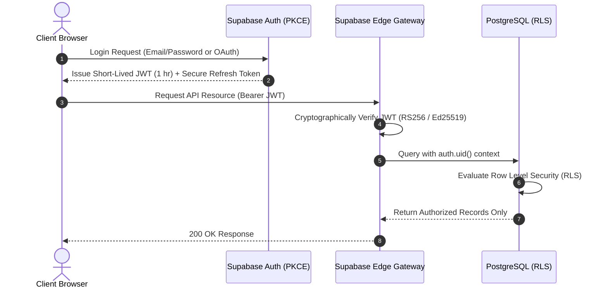
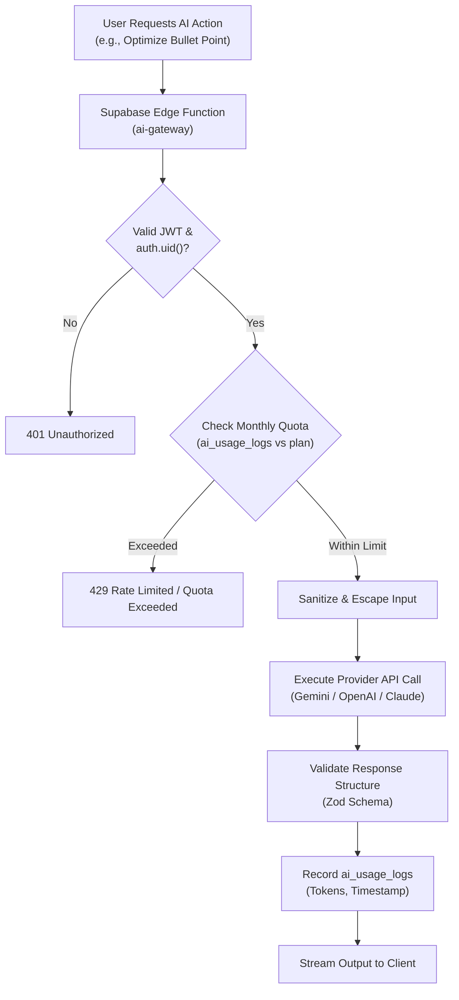

# Security Architecture & Threat Model — ResuMax AI

**Status:** Phase 0 Approved Architecture  
**Security Baseline:** OWASP Top 10, Zero-Trust API Architecture, SOC 2 / GDPR Alignment

---

## 1. Threat Modeling & Core Security Tenets

ResuMax AI handles sensitive personally identifiable information (PII)—including candidate work history, contact information, career ambitions, and compensation details.

### Core Security Principles:
1. **Zero-Trust Client Boundary:** The frontend SPA is treated as untrusted. No administrative database credentials, service-role keys, or AI provider API tokens are ever delivered to or bundled within the client browser.
2. **Mandatory Row Level Security (RLS):** Every PostgreSQL table enforces strict RLS policies. Even in the event of an insecure API endpoint, database-level security prevents unauthorized cross-tenant data access.
3. **Defense-in-Depth for File Processing:** Uploaded resume files are validated at three separate checkpoints: browser extension/type check, Edge Function magic-byte inspection, and sandboxed AST parsing.
4. **LLM Prompt Injection Mitigation:** All user-supplied resumes and job descriptions are isolated in system prompts using XML/JSON delimiter envelopes with strict schema validation.

---

## 2. Authentication & Session Management



* **Authentication Protocol:** Supabase Auth using **PKCE (Proof Key for Code Exchange)** for both passwordless and OAuth flows.
* **Token Lifecycle:**
  * Access Tokens: Short-lived JWTs (60-minute expiration).
  * Refresh Tokens: Stored in secure, `HttpOnly`, `SameSite=Lax` browser cookies with automatic token rotation.
* **Session Invalidation:** Immediate revocation of refresh tokens upon user sign-out or suspicious password reset events.

---

## 3. Row Level Security (RLS) Architecture

Every table in the PostgreSQL database has RLS permanently enabled (`ALTER TABLE <name> ENABLE ROW LEVEL SECURITY;`).

### Standard Policy Patterns:

#### Pattern A: Direct User Ownership (`profiles`, `resumes`, `job_descriptions`, `ai_conversations`)
```sql
-- Restrict SELECT to record owner
CREATE POLICY "Users can only view their own records"
ON resumes FOR SELECT
USING (auth.uid() = user_id);

-- Restrict UPDATE to record owner
CREATE POLICY "Users can only update their own records"
ON resumes FOR UPDATE
USING (auth.uid() = user_id)
WITH CHECK (auth.uid() = user_id);

-- Restrict DELETE to record owner
CREATE POLICY "Users can only delete their own records"
ON resumes FOR DELETE
USING (auth.uid() = user_id);
```

#### Pattern B: Relational Cascaded Ownership (`resume_sections`, `resume_versions`)
```sql
-- Verify parent resume ownership
CREATE POLICY "Users can manage sections of their own resumes"
ON resume_sections FOR ALL
USING (
  EXISTS (
    SELECT 1 FROM resumes
    WHERE resumes.id = resume_sections.resume_id
    AND resumes.user_id = auth.uid()
  )
);
```

#### Pattern C: Service-Role Only Mutations (`subscription_plans`, `ai_usage_logs`, `subscriptions`)
* Authenticated users can read their own logs or active plans (`auth.uid() = user_id`).
* `INSERT`, `UPDATE`, and `DELETE` privileges are granted exclusively to `service_role` (invoked only by secure Supabase Edge Functions).

---

## 4. Supabase Storage Security & Bucket Policies

| Bucket Name | Privacy Level | Max File Size | Allowed MIME Types | Access Policy |
| :--- | :--- | :--- | :--- | :--- |
| `resumes` | **Private** | 5 MB | `application/pdf`, `application/vnd.openxmlformats-officedocument.wordprocessingml.document` | Owner-only read/write via signed URLs (`(bucket_id = 'resumes' AND auth.uid()::text = (storage.foldername(name))[1])`) |
| `exports` | **Private** | 10 MB | `application/pdf`, `application/vnd.openxmlformats-officedocument.wordprocessingml.document` | Generated files accessed via 15-minute time-expiring signed URLs. |
| `avatars` | **Restricted** | 2 MB | `image/png`, `image/jpeg`, `image/webp` | Authenticated upload; public CDN read. |

---

## 5. File Upload Validation & Malware Defense

To prevent malicious executable uploads (e.g. Polyglot PDFs, executable macro Word files):

1. **Client-Side Pre-Validation:**
   * File extension check (`.pdf`, `.docx`).
   * Size threshold validation (`<= 5,242,880 bytes`).
2. **Server-Side Edge Verification:**
   * **Magic Byte Sniffing:**
     * PDF: Must begin with `%PDF-` (`0x25 0x50 0x44 0x46`).
     * DOCX: Must conform to standard ZIP header signature (`0x50 0x4B 0x03 0x04`).
   * **Buffer De-nesting:** Files are decoded in isolated memory workers using pure-JS parsers (`unpdf`) without native shell execution or unsafe system calls.

---

## 6. Server-Side AI API Protection & Rate Limiting



* **No Frontend API Keys:** `GEMINI_API_KEY`, `OPENAI_API_KEY`, and `ANTHROPIC_API_KEY` reside exclusively in Supabase Vault / Edge Function secrets.
* **Tier-Based Rate Limiting:**
  * Sliding-window rate limiter (e.g., maximum 10 requests/minute per user) implemented via Redis/Upstash or Postgres lockless counters.
  * Monthly hard quota enforcement directly in PostgreSQL transactions before executing LLM calls.
* **Prompt Injection Defense:**
  * User-supplied text is sanitized to remove delimiter hijacking patterns (e.g., `</system>`, `[SYSTEM INSTRUCTION]`).
  * Inputs are passed as strictly typed JSON objects rather than unstructured raw prompt interpolations.

---

## 7. Payment Webhook Security (Stripe Integration)

* **Cryptographic Signature Verification:**
  * Every incoming webhook payload from Stripe is verified against `STRIPE_WEBHOOK_SECRET` using HMAC SHA-256.
  * Requests with missing, expired, or invalid signatures are rejected immediately with `400 Bad Request`.
* **Idempotency Keys:**
  * Event IDs from Stripe (`event.id`) are recorded in PostgreSQL to prevent duplicate credit provisioning during webhook retries.

---

## 8. Environment Variable Governance

All secret tokens follow strict separation between public client variables and private backend secrets:

### Public Frontend Variables (`.env.production` / Vite build):
```bash
VITE_SUPABASE_URL=https://<project-ref>.supabase.co
VITE_SUPABASE_ANON_KEY=eyJhbGciOi... (Safe public anonymous key with RLS enforcement)
VITE_APP_URL=https://resumax.ai
```

### Private Backend Variables (Supabase Edge Vault only — NEVER in Git or Client):
```bash
SUPABASE_SERVICE_ROLE_KEY=eyJhbGciOi... (Bypasses RLS - Edge Functions only)
GEMINI_API_KEY=AIzaSy...
OPENAI_API_KEY=sk-proj-...
ANTHROPIC_API_KEY=sk-ant-...
STRIPE_SECRET_KEY=sk_live_...
STRIPE_WEBHOOK_SECRET=whsec_...
```
