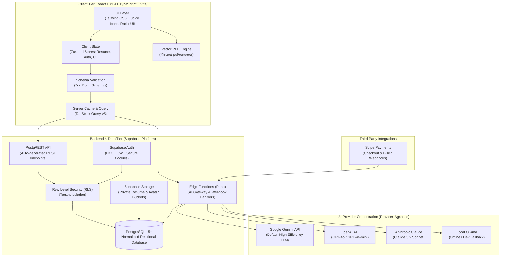

# System Architecture Specification — ResuMax AI

**Status:** Phase 0 Approved Architecture  
**Target Platform:** Web (Modern Desktop & Mobile Browsers)  
**Hosting Environment:** Netlify (Frontend SPA) + Supabase (Database, Auth, Storage, Edge Functions)

---

## 1. High-Level Architectural Topology



---

## 2. Frontend Architecture

### 2.1 Technology Stack & Rationale
* **Build Tool:** **Vite** — Sub-second cold starts, instant Hot Module Replacement (HMR), and native ESM packaging.
* **Core Framework:** **React 18 / 19** with **TypeScript** — Strict type definitions across the entire resume schema prevent runtime property errors.
* **Styling Engine:** **Tailwind CSS** — Utility-first, purgeable CSS ensuring tiny bundle sizes and consistent design tokens.
* **Iconography:** **Lucide React** — Modern, clean tree-shakeable icons.
* **State Management:**
  * **Zustand:** Ultra-lightweight global stores for local client state:
    * `useResumeStore`: Active resume draft, active section, unsaved changes, zoom factor.
    * `useAuthStore`: Session token, active user profile, subscription tier.
    * `useUIStore`: Modals, notifications, theme (light/dark), side drawers.
  * **TanStack Query (React Query v5):** Robust asynchronous server-state cache for fetching resumes, ATS reports, and job matches with built-in background revalidation.
* **Form & Validation Layer:** **React Hook Form** + **Zod** — Zero re-renders during typing, with instant validation against strongly typed schemas.

### 2.2 Component Directory Structure (Planned for Phase 1)
```
src/
├── assets/             # Brand SVGs, static logos, typography fonts
├── components/
│   ├── common/         # Button, Input, Modal, Dropdown, Card, Toast, Badge
│   ├── layout/         # Navbar, Sidebar, Footer, DashboardLayout, AppShell
│   ├── builder/        # ResumeBuilder, SectionTabs, DragDropWrapper, LivePreview
│   ├── templates/      # JakesTemplate, HarvardTemplate, StanfordTemplate, TechClean
│   ├── analyzer/       # ScoreCard, MetricProgress, BulletFixer, KeywordBadges
│   ├── copilot/        # ChatDrawer, MessageList, QuickPrompts, ContextPills
│   └── jobs/           # JobMatcher, KeywordDiff, TailoredDiffViewer
├── hooks/              # useDebounce, useAutoSave, usePDFExport, useMediaQuery
├── lib/                # supabaseClient, zodSchemas, constants, utils
├── services/           # resumeService, atsService, aiService, paymentService
├── stores/             # resumeStore, authStore, uiStore
└── types/              # resume.ts, ats.ts, user.ts, api.ts, database.types.ts
```

---

## 3. Backend & Data Architecture

### 3.1 Supabase Hosted Stack
* **PostgreSQL 15+:** Fully relational database schema enforcing referential integrity across users, resumes, sections, reports, and payments.
* **Row Level Security (RLS):** All data access is mediated through PostgreSQL security policies (`auth.uid() = user_id`), ensuring zero cross-tenant data leakage even if a query is misconstructed.
* **PostgREST API:** Provides auto-generated, type-safe REST endpoints that communicate directly with our TanStack Query client.
* **Supabase Storage:**
  * `resumes`: Private bucket holding uploaded candidate resumes (`.pdf`, `.docx`) for analysis.
  * `avatars`: Public/restricted bucket for optional user profile pictures.
  * `exports`: Private bucket for generated vector PDFs and Word documents.

### 3.2 Supabase Edge Functions (Deno / TypeScript)
Rather than making direct AI calls from the frontend, all proprietary and billable AI interactions are routed through secure, low-latency Edge Functions:
1. `ai-gateway`:
   * Validates user authentication JWT.
   * Checks current monthly usage quota against user's subscription tier in PostgreSQL.
   * Injects system prompts and executes LLM calls with streaming responses.
   * Logs token consumption into `ai_usage_logs`.
2. `resume-parser`:
   * Ingests uploaded PDF/DOCX files.
   * Extracts clean structured text and maps it into standard JSON AST.
3. `stripe-webhook`:
   * Verifies incoming Stripe cryptographic signatures.
   * Updates `subscriptions` and `payment_transactions` tables on successful renewals or cancellations.

---

## 4. AI Service Abstraction Architecture

To avoid vendor lock-in and provide maximum resilience, ResuMax AI implements a **Provider-Agnostic AI Adapter Pattern**:

```typescript
// Conceptual Interface
export interface IAIService {
  scoreResume(resumeText: string): Promise<ATSScoreResult>;
  optimizeBulletPoint(bullet: string, context?: string): Promise<BulletOptimizationResult>;
  tailorResume(resumeJson: ResumeData, jobSpec: string): Promise<TailoredResumeResult>;
  chatWithCopilot(messages: ChatMessage[], resumeContext: ResumeData): AsyncIterable<string>;
}
```

* **Adapters Supported:**
  1. `GeminiAdapter`: Powered by Google Gemini (e.g. Gemini 1.5 Flash / Pro) — high throughput, fast latency, cost-effective default.
  2. `OpenAIAdapter`: OpenAI GPT-4o / GPT-4o-mini — high-fidelity reasoning benchmark.
  3. `AnthropicAdapter`: Claude 3.5 Sonnet — superior nuance in professional and technical writing.
  4. `OllamaAdapter`: Local offline LLM (e.g., Llama 3 / Mistral) for local development without API spend.
* **Structured Outputs:** All analytical LLM prompts use strict **JSON Schema enforcement** to ensure output is parseable by Zod schemas without markdown formatting noise.

---

## 5. Document Processing & Export Engine

### 5.1 The Vector Text-Stream PDF Problem & Solution
* **The Legacy Flaw:** The existing `ResumeForge` used `html2pdf.js`, which renders the DOM as a JPEG/PNG image onto a PDF canvas. Automated ATS crawlers see zero selectable text, resulting in immediate parsing failure.
* **The ResuMax AI Solution:**
  * ResuMax AI uses `@react-pdf/renderer` or server-side headless Chromium PDF rendering.
  * Generates true **Vector Text-Stream PDFs** using embedded standard fonts (Helvetica, Times-Roman, Computer Modern).
  * Every character is individually selectable, indexed, and semantic.
  * Hyperlinks (LinkedIn, GitHub, portfolio) are preserved as clickable PDF annotations.

### 5.2 Word (.docx) Generation
* Implemented using the `docx` library in TypeScript.
* Maps resume sections into native Word headings, paragraphs, and unordered lists, maintaining standard margins (0.75" / 1") and typography.
